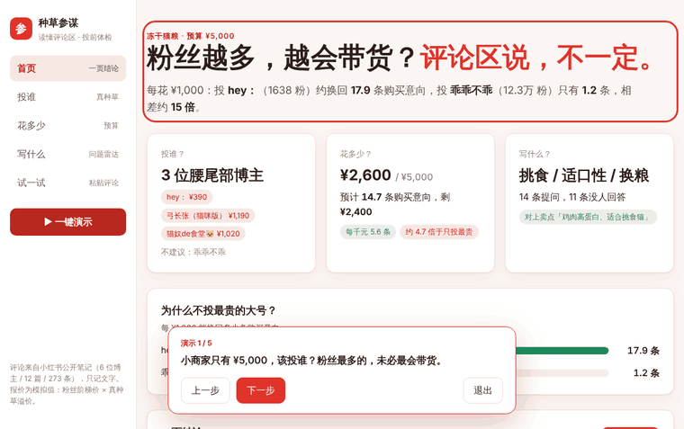
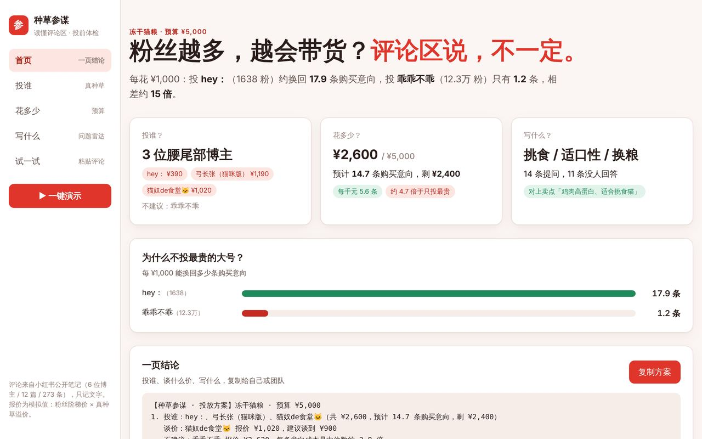

# 种草参谋

**读懂小红书评论区，帮预算有限的小商家在投放前判断：投谁、花多少、写什么。**

> 小红书大商业校招 AI Builder Test 参赛作品。原版在 REDCowork 上 48 小时内完成，本仓库是用 Claude Code 从零复刻的独立版本，纯前端，打开就能用。

**在线体验**：[victoria0115-ops.github.io/zhongcao-demo](https://victoria0115-ops.github.io/zhongcao-demo/)　·　以冻干猫粮品类为例，评论全部来自小红书公开笔记



---

## 一句话

粉丝多、报价高、评论热闹，都不等于种草多。种草参谋把评论区读一遍，告诉小商家钱该花在哪。

## 要解决的问题

一个只有几千元预算的小商家，在小红书上选博主时，手里只有粉丝数、点赞和一个报价。这会带来三个问题：

| 问题 | 具体表现 |
|---|---|
| 分不清真种草和假热闹 | 点赞和评论可能来自抽奖、夸猫可爱，甚至控评，不代表有人想买 |
| 不知道钱该花给谁 | 报价没有参照，不知道贵不贵、怎么谈价；几千元预算不知道怎么分 |
| 看不到用户真正在问什么 | 「挑食猫能吃吗」「绝育后怎么喂」散在评论区，常常没人回答 |

大品牌有代理商和数据团队，中小商家没有。他们试错成本最高，也最容易投一次没效果就流失。

## 核心思路：答案在评论区

所有功能都建立在同一步上：**先给每条评论打标签，再分别算种草分、成本和问题。**

```
真实评论 ──► 7 类标签 ──► ① 真种草分（投谁）
                       ├► ② 每条购买意向成本（花多少）
                       └► ③ 高频未回答问题（写什么）──► 一页结论
```

**7 类评论标签**（每条只取一个）：

| 标签 | 例子 | 算不算购买意向 |
|---|---|---|
| 问渠道 | 求链接、什么牌子呀 | 是 |
| 问规格 | 多少克、一般什么时候有活动 | 是 |
| 问适用 | 绝育后挑食能吃吗、玻璃胃能吃吗 | 是 |
| 已购 | 已下单、回购第三次了 | 是 |
| 提问-其他 | 和购买无关的提问 | 否 |
| 顾虑或负面 | 太贵了、我家猫不爱吃 | 否 |
| 无关 | 抽奖、纯表情、夸猫可爱、客套 | 否 |

「购买意向」可以看成 **CPE（每次互动成本）的细化版**：CPE 把所有点赞评论一视同仁，这里只算真正想买或已经买了的互动，更接近转化，又能在投放前拿到。

## 五个页面

| 页面 | 回答什么 | 截图 |
|---|---|---|
| 首页 · 一页结论 | 投谁、花多少、写什么，可一键复制 | [查看](docs/screenshots/home.jpg) |
| 投谁 · 真种草评分 | 谁是真种草，谁只是热闹；点开能看到命中的原评论 | [查看](docs/screenshots/score.jpg) |
| 花多少 · 预算方案 | 预算内的最优组合、谁该谈价、谁不建议；滑块实时重算 | [查看](docs/screenshots/budget.jpg) |
| 写什么 · 问题雷达 | 用户问得最多、却没人回答的问题，和商家卖点对照 | [查看](docs/screenshots/radar.jpg) |
| 试一试 | 粘贴任意评论，现场打标 | [查看](docs/screenshots/try.jpg) |



## 在真实数据上的结论（预算 ¥5,000）

| 博主 | 粉丝 | 模拟报价 | 真种草分 | 每条意向成本 | 结论 |
|---|---|---|---|---|---|
| hey： | 1638 | ¥390 | 100 | ¥56 | 值得投（只有 1 篇，样本少） |
| 弓长张（猫咪版） | 4.1 万 | ¥1,190 | 78 | ¥255 | 值得投 |
| 猫奴de食堂 | 1.1 万 | ¥1,020 | 43 | ¥340 | 偏贵可谈价，建议 ¥900；评论热闹但种草低 |
| 乖乖不乖 | 12.3 万 | ¥3,620 | 81 | ¥835 | 不建议，成本是中位数的 2.8 倍；疑似控评 |

- **推荐组合**：hey： + 弓长张 + 猫奴de食堂，花 ¥2,600，预计 14.7 条购买意向（每千元 5.6 条），还剩 ¥2,400。
- **对照**：只投报价最高的乖乖不乖，花 ¥3,620，预计 4.3 条（每千元 1.2 条）。**推荐组合的每千元种草效率约是它的 4.7 倍。**
- **单个博主对比**：每花 ¥1,000，hey： 换回 17.9 条，乖乖不乖 1.2 条，相差约 15 倍。
- **问题雷达**：41 条提问里，「挑食 / 适口性 / 换粮」最集中，14 条里 11 条没人回答，正好对上卖点「适合挑食猫」。

一个反直觉的发现：乖乖不乖的种草分其实排第二（81），但它报价最高、夸赞类评论占 22%（同类中位数只有 1.8%），算下来每条意向成本最贵。**种草分看评论质量，成本看性价比，两者要一起看。**

## 计算规则

每个数字都可以手算复现，测试里也逐一核对过。

| 指标 | 规则 |
|---|---|
| 分组 | 粉丝 ≥ 1000 为「可投放博主」，参与评分和预算；以下为「潜力 KOC」，只观察 |
| 真种草分 | `0.6 × 购买意向占比得分 + 0.4 × 平均每篇购买意向得分`，两项都是「该值 ÷ 组内最高 × 100」 |
| 疑似控评 | 夸赞/客套类评论占比 ≥ 15%，且 ≥ 组内中位数的 5 倍 |
| 评论热闹但种草低 | 平均评论数排前一半，购买意向占比排后一半 |
| 模拟报价 | `粉丝阶梯价 × (0.8 + 0.5 × 真种草分 ÷ 100)`，取整到 10 元 |
| 每条意向成本 | `报价 ÷ 平均每篇购买意向数` |
| 三档判断 | ≤ 中位数 值得投；1–1.5 倍 偏贵可谈价（建议价 = 中位数 × 平均意向数，取整百）；更高 不建议 |
| 推荐组合 | 按每条意向成本从低到高，在预算内依次选入，每人 1 篇 |
| 问题排序 | `提问数 × 没被回答比例`；「其他问题」不参与排序 |

关于报价：博主真实报价不公开，这里用模拟值。种草分高的博主会被加价、更难被推荐，所以推荐结论是**偏保守**的。接入真实报价只需要替换 `js/calc/quote.js`。

## 项目结构

数据、计算、展示分开：换品类只换数据，接真实报价只换一个文件。

```
├── index.html            页面入口
├── css/style.css         样式（支持浅色 / 深色、手机宽度）
├── data/raw.json         采集的原始数据（评论文字 + 参考标签）
├── tools/build_data.py   raw.json → js/data.js
├── js/
│   ├── data.js           数据层（自动生成）
│   ├── calc/             计算层，纯函数，浏览器和 Node 都能跑
│   │   ├── util.js       公共工具
│   │   ├── engine.js     计数：标签数、购买意向
│   │   ├── score.js      真种草分 + 异常标记
│   │   ├── quote.js      模拟报价
│   │   ├── budget.js     成本、三档判断、推荐组合
│   │   ├── radar.js      问题雷达
│   │   ├── tagger.js     「试一试」关键词打标
│   │   └── summary.js    串起所有模块，生成一页结论
│   ├── app.js            展示层：五个页面，只画不算
│   └── demo.js           一键演示 5 步，数字实时读取
└── tests/calc.test.js    17 项测试，核对所有关键数字
```

## 怎么运行

不需要安装任何依赖。

```bash
# 1. 直接用浏览器打开
open index.html

# 2. 跑计算层测试（需要 Node）
node tests/calc.test.js

# 3. 换成自己的数据后重新生成 data.js
python3 tools/build_data.py data/raw.json
```

## 数据说明与局限

- **评论是真实的**：从小红书公开笔记手动采集，6 位博主、12 篇笔记、273 条评论，只记录评论文字，不记录评论者。
- **报价是模拟的**：按「粉丝阶梯价 × 种草溢价」估算，页面已标明。
- **样本小**：每篇只取前 30 条左右评论，部分博主只有 1 篇笔记，所以只给三档结论并标出「样本少」。
- **打标用关键词规则**：会有误判（反话、没有关键词的提问），正式版应换成大模型打标并人工抽检准确率。
- **购买意向不等于成交**：它是比点赞更接近转化的种草信号，正式版应用笔记发布后的销量变化来校准权重。
- 博主数据仅用于方法演示，不构成对任何博主的评价；「疑似控评」只是基于评论文字的统计提示，并列出了依据。

## 下一步

- 大模型实时打标，并抽检准确率
- 接入蒲公英真实报价和投后数据，从「投前体检」延伸到「投后复盘」
- 把问题雷达的高频问题直接变成搜索关键词和选题建议
- 按效果付费的合作建议（保底价 + 每多一条购买意向加奖励）
- 理想形态：蒲公英里给中小商家用的 AI 投放助手

## 制作过程

1. 先定主线和模块结构（数据层、计算层、展示层分开），用模拟数据搭骨架。
2. 自己从小红书公开笔记采集真实评论，替换模拟数据。
3. 一个模块一个模块地让 AI 实现，每步用手算的数字核对。
4. 发现真实数据里「点赞高但种草低」并没有出现，于是按数据把主线调整为「粉丝多、报价高，不等于种草多」，而不是改数据去迎合设想。
5. 提交后，用 Claude Code 脱离原平台从零复刻，补全了原版缺的一页结论模块，加上自动化测试。

---

作者：郭昱彤
